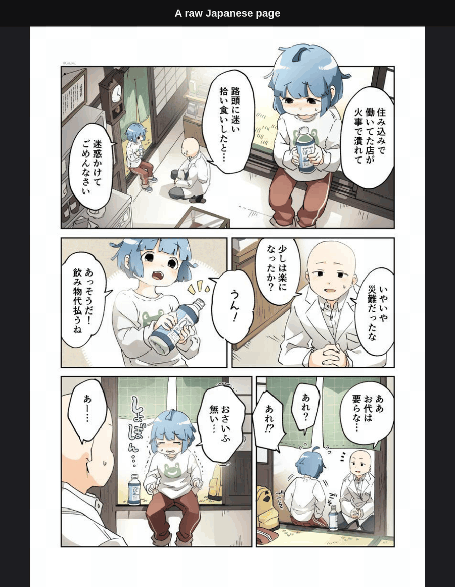

<p align="center"></p>

# Yomikae

[](LICENSE)


Yomikae translates raw Japanese manga into English while you read it in Chrome. A browser extension sends each page image to a server on your own computer. The server finds the text, reads it, translates it with a local LLM, erases the Japanese, and letters the English into the speech balloons. The extension then shows the translated page in place of the original.

The name comes from 読み替え (yomikae), Japanese for "reading something as something else."



*Demo pages from the OpenMantra dataset (Hinami et al., AAAI 2021), CC BY-NC 4.0, translated by Yomikae.*

## What reading with Yomikae looks like

- Switch Yomikae on for a site and read as usual. In automatic mode, each page shows up in English in the same place on the site.
- While you read a page, the extension translates the pages after it, so they can be ready before you turn to them.
- Hold **Alt** to see the original Japanese page. Let go to go back to English.
- Hover a page to see its chip in the top right corner. The chip shows progress while the page translates, and **Retry** if it failed.
- To report a bad page, click **Report** in the chip or press **Alt+R**. Click the bubbles that are wrong or drag a box around text that was missed, type a note, and press Enter. The server saves the original page, the render, and your marks to `~/.local/share/yomikae/reports/`.
- To fix some bubbles, click **Retranslate** in the chip or press **Alt+T**. Click the bubbles to translate again, add a hint such as "Lene is a girl" or fix a name in Japanese and English, and press Enter. Only those bubbles change, and the page updates in place.
- The cast sheet in Chrome's side panel lists the characters and terms of the work you are reading, with their English spellings. Open it from the popup. You can respell, delete, add, or switch an entry between character and term. Pages that still use an old spelling are redone the next time you look at them.
- If the server stops, pages show "Waiting for server…" and continue when it comes back. You don't need to reload the tab.
- The server caches every translated page on disk, so a page you have read before loads at once.

## Sites

Yomikae has built-in adapters for pixiv and X (x.com and twitter.com). An adapter knows which images on a site are pages, fetches the full-size original, groups the pages of one work so the translator sees earlier pages as context, and finds the next pages to translate ahead of you. Both sites start in click-to-translate mode, so nothing is translated until you click **Translate** on an image.

Any other site works in click-to-translate mode. Hover an image that is at least 200 px on each side and click **Translate** in its chip. In the popup you can switch a site to translate every page automatically instead.

[docs/sites.md](docs/sites.md) lists every built-in adapter with its default mode, the access it asks for, what it prefetches, and its known limits. To build an adapter for another site into your own copy, see [docs/adapters.md](docs/adapters.md).

## Requirements

- Python 3.12 or newer, [uv](https://docs.astral.sh/uv/), git, and a C++ compiler. The install builds `pydensecrf` from source.
- Node.js 22.23.4, 24.22.1 or 26.12.1 or newer, and pnpm, to build and test the extension. Older releases have the Brotli decoder flaw CVE-2026-111497.
- Chrome or Chromium 116 or newer.
- An LLM server with an OpenAI-compatible API, such as [LM Studio](https://lmstudio.ai/) or Ollama, or a cloud API.
- An NVIDIA GPU with CUDA for the default setup.

### Hardware

Yomikae was developed on Linux with an NVIDIA GeForce RTX 5070 Ti (16 GB). Other platforms are untested.

The default setup runs the server and the LLM on one GPU. On that machine, LM Studio holds about 9.7 GB for the 12B Gemma 4 build used in development, and the server a few GB: every model on the GPU, with the text detector's and balloon segmenter's memory pools capped at 1.5 GB each. All GPU work runs on one thread and the server gives back its working memory after every page, so it stays at about 3.1 GB while you read. `YOMIKAE_DETECT_DEVICE=cpu` moves detection to the CPU, saving that GPU memory for about 0.95 s more per page. If the GPU is still too full, `YOMIKAE_LOW_VRAM=1` runs everything on the CPU and the server uses no GPU memory, at about 2 s more per page plus about 0.9 s for each patch of text on screentone or art. [docs/performance.md](docs/performance.md) has the measurements.

Translation is the heavy part. Detection, OCR, erasing, and lettering need much less. When CUDA is not available, the server runs those steps on the CPU, at about 1.4 to 4.6 s per page on real OpenMantra pages (median 2.8 s) and about 2 s in a `server/tools/strip_bench.py` run on a synthetic page with plain white bubbles, on an 8-core desktop CPU. Each patch of text on screentone or art goes through LaMa, at about 1 s each on the CPU, so pages with a lot of such text take longer. The install steps below install the CUDA build of PyTorch, and a CPU-only install is not documented or tested.

The LLM does not have to run on the same machine. Point `YOMIKAE_OPENAI_BASE_URL` at another computer on your network or at a cloud API. With a cloud API, the Japanese text of each page leaves your computer, along with the dialogue of up to two earlier pages as context. Page images never leave it. Cloud models may refuse some content, which leaves those lines in Japanese or fails the page.

## Install

### 1. Set up the server

From `server/` in a clone of this repo:

```sh
uv venv --python 3.12 .venv
uv pip install --python .venv/bin/python torch --index-url https://download.pytorch.org/whl/cu128
uv pip install --python .venv/bin/python -e '.[test]'
```

The server needs three model files in `server/models/`, which the repo does not include. Download the text detector and the inpainting model:

```sh
mkdir -p models
curl -L -o models/comictextdetector.pt.onnx https://github.com/zyddnys/manga-image-translator/releases/download/beta-0.3/comictextdetector.pt.onnx
curl -L -o models/lama_large_512px.ckpt https://huggingface.co/dreMaz/AnimeMangaInpainting/resolve/main/lama_large_512px.ckpt
```

The speech balloon segmenter ships only as PyTorch weights, so export it to ONNX once. Run `yolo` from a separate venv that has `ultralytics` installed, not from the server venv:

```sh
curl -L -o best.pt https://huggingface.co/huyvux3005/manga109-segmentation-bubble/resolve/main/best.pt
yolo export model=best.pt format=onnx imgsz=1600 opset=17 simplify=True
mv best.onnx models/manga109-bubble-seg.onnx
rm best.pt
```

manga-ocr downloads its own weights from Hugging Face the first time the server starts.

The open-licensed fonts are in `server/fonts/`. Anime Ace 2 is free for personal use only, so the repo does not include it. To letter dialogue in it, get it from [Blambot](https://blambot.com/) and put `animeace2_reg.ttf` in `server/fonts/`. Without it, dialogue is set in Shantell Sans.

Start the server:

```sh
.venv/bin/uvicorn yomikae.app:app --host 127.0.0.1 --port 7878
```

Startup loads and warms every model. Check it with `curl http://127.0.0.1:7878/v1/health`.

### 2. Start a translator

The default translator is LM Studio's server at `http://localhost:1234/v1` with Google's Gemma 4 12B instruct model, which LM Studio lists as `google/gemma-4-12b`. Install LM Studio, then download the model, load it, and start the server:

```sh
lms get google/gemma-4-12b
lms load google/gemma-4-12b -y
lms server start
```

Any OpenAI-compatible model works. To use another one, set `YOMIKAE_OPENAI_MODEL` to the name the endpoint knows it by. Pick a model that handles Japanese. [docs/models.md](docs/models.md) suggests models for each amount of graphics memory.

Any other server with an OpenAI-compatible `/chat/completions` endpoint works too. For Ollama, set `YOMIKAE_OPENAI_BASE_URL=http://localhost:11434/v1`. For a cloud API, also set `YOMIKAE_OPENAI_API_KEY`. The endpoint must accept `response_format` with a JSON schema, because the server asks for structured output.

### 3. Load the extension

From `extension/`:

```sh
pnpm install
pnpm build
```

1. Open `chrome://extensions` and switch on **Developer mode**.
2. Click **Load unpacked** and select `extension/dist`.
3. Open a page of the manga you want to read and click the Yomikae toolbar icon.
4. Switch on **Translate** for the site and allow access when Chrome asks.
5. Choose **Every page, automatically** or **Only images I click Translate on**.

The popup also shows whether the server is running. When it is not, the popup prints the start command to run from the root of your clone.

The extension talks to `http://127.0.0.1:7878`. It has no settings page. The browser tests point it at a mock server through a `serverUrl` key in `chrome.storage.local`, a test hook that nothing in the extension writes.

## Configuration

The server reads environment variables. These are the ones you are most likely to change:

| Variable | Default | Meaning |
| --- | --- | --- |
| `YOMIKAE_TRANSLATOR` | `openai` | `openai` for any OpenAI-compatible endpoint, or `google_free` for a keyless Google endpoint that gets no context. |
| `YOMIKAE_OPENAI_BASE_URL` | `http://localhost:1234/v1` | The translator endpoint. |
| `YOMIKAE_OPENAI_MODEL` | `google/gemma-4-12b` | The model name sent to the endpoint. Any OpenAI-compatible model works. |
| `YOMIKAE_OPENAI_API_KEY` | `lm-studio` | The bearer token. |
| `YOMIKAE_OPENAI_REASONING_EFFORT` | `none` | Sent as `reasoning_effort`. Set it to an empty string for endpoints that reject the field. |
| `YOMIKAE_CASE` | `upper` | `upper` letters dialogue in capitals. `mixed` keeps the translation's casing and uses Comic Neue. |
| `YOMIKAE_BUBBLE_MODEL` | `manga109-bubble-seg.onnx` | The balloon segmenter's file name in `server/models/`. |
| `YOMIKAE_DETECT_DEVICE` | `cuda` | `cuda` or `cpu`, where text detection and balloon segmentation run. `cpu` saves GPU memory and takes about 0.95 s more per page. `YOMIKAE_LOW_VRAM=1` always uses the CPU. |
| `YOMIKAE_LOW_VRAM` | off | `1` runs OCR and inpainting on the CPU too, so the server uses no GPU memory. Pages take longer, most of all pages with text on art. |
| `YOMIKAE_CACHE_DIR` | `server/cache` | Where translated pages are cached. |
| `YOMIKAE_CACHE_MAX_BYTES` | `2147483648` (2 GiB) | The cache size limit. Past it, the least recently read pages are deleted first. |
| `YOMIKAE_REPORTS_DIR` | `~/.local/share/yomikae/reports` | Where page reports are saved. |

For example, to translate with a cloud API:

```sh
YOMIKAE_OPENAI_BASE_URL=https://api.example.com/v1 \
YOMIKAE_OPENAI_MODEL=<model> \
YOMIKAE_OPENAI_API_KEY=<key> \
.venv/bin/uvicorn yomikae.app:app --host 127.0.0.1 --port 7878
```

[server/README.md](server/README.md#configuration) lists every variable, including the font overrides.

## How it works

The extension finds page images, fetches their bytes with your browser session, and posts them to the local server. The server never fetches a URL itself. For each page, the server does the following:

1. comic-text-detector finds the text blocks and a mask of the lettering.
2. A YOLO11 segmentation model trained on manga finds each speech balloon's outline. A flood fill finds the bubbles it misses.
3. manga-ocr reads the Japanese in each block. Sound effects and unsure readings are dropped.
4. The translator gets the whole page in one call, with up to two earlier pages of the same work as context and the names already used in it. A line that already has a translation in the same work reuses it, so a repeated caption reads the same on every page. The prompt tells the model to keep honorifics, so 田中さん becomes "Tanaka-san".
5. Plain bubbles are filled with their own color. Text on screentone or art is erased with a manga-tuned LaMa model.
6. The English is set in the balloon's shape, in capitals, hyphenated with pyphen only when a word cannot fit whole. Shouts are set larger in Bangers.

Long vertical strips and wide spreads are read in overlapping tiles. Results are cached on disk by the SHA-256 of the image bytes.

[server/README.md](server/README.md#pipeline) describes each stage in detail. [docs/contract.md](docs/contract.md) is the HTTP API and the extension's behavior.

## Benchmarks

Two tools in `server/tools/` measure quality. Neither dataset is in this repo.

`benchmark.py` runs the full pipeline on a folder of held-out pages, with one subfolder per work. It writes each render, a sheet of the original beside the render, and automated metrics: Japanese still detected on the render, English ink outside its bubble, lettering size against the source lettering, and per-stage timings. It also writes a `review.json` to fill in by hand from the sheets. The headline number is problems per 100 bubbles, by category: missed text, missed small balloons, text outside its bubble, bad size, bad placement, translated non-dialogue, duplicates, and inpainting smudges.

```sh
cd server
.venv/bin/python tools/benchmark.py PAGES_DIR --out-root RUNS_DIR --label NAME
.venv/bin/python tools/benchmark.py --out-root RUNS_DIR --label NAME --score
```

Run the second command after you fill in `review.json`. `--device cpu` runs without the GPU, and `--replay RUN_DIR` reuses an earlier run's translations so a typesetting change compares on the same text.

`translation_bench.py` measures translation alone on [OpenMantra](https://github.com/mantra-inc/open-mantra-dataset). It sends the gold Japanese of each bubble through the same page translation code the server uses, one page per call, in reading order, with one context per series. It scores COMET (`Unbabel/wmt22-comet-da`) with a 95% bootstrap interval, chrF with and without case, blank lines, and how often the translation keeps honorifics on names compared with the professional reference. It needs the server's `bench` extra, which installs `sacrebleu`, and COMET in a second venv at `server/.venv-comet`:

```sh
cd server
uv pip install --python .venv/bin/python -e '.[bench]'
uv venv --python 3.12 .venv-comet
uv pip install --python .venv-comet/bin/python unbabel-comet
.venv/bin/python tools/translation_bench.py PATH/TO/open-mantra-dataset/annotation.json --out-root RUNS_DIR --label NAME
```

OpenMantra is by Ryota Hinami, Shonosuke Ishiwatari, Kazuhiko Yasuda, and Yusuke Matsui, from "Towards Fully Automated Manga Translation" (AAAI 2021). It is licensed CC BY-NC 4.0. Clone it yourself.

`strip_bench.py` builds long strips from synthetic pages and reports text recall, timings, and GPU memory per strip. It runs without a translator.

[docs/benchmarks.md](docs/benchmarks.md) explains how much the scores move between runs and the mistakes that void a comparison.

## Credits and licenses

Yomikae is licensed under version 3 of the GNU General Public License only (GPL-3.0-only, see [LICENSE](LICENSE)), the same terms as manga-image-translator, which parts of the server are ported from.

`docs/media/demo.gif` is not GPL. It shows OpenMantra pages and is licensed CC BY-NC 4.0, like the dataset.

### Code ported from other projects

Several parts of the server are ported from [zyddnys/manga-image-translator](https://github.com/zyddnys/manga-image-translator) (GPL-3.0): the text mask refinement and glyph-scaled dilation, the LaMa inpainting generator, retrying a misaligned translation batch in halves, the floor that keeps English at least as large as the source lettering, and two detection recall passes. [server/README.md](server/README.md#credits) names the source file for each.

The typesetting rules follow AnonBlack's Typesetting Guide. [docs/typesetting-notes.md](docs/typesetting-notes.md) maps each rule to the code.

### Models

The repo includes no model weights. You download them during install.

| Model | Used for | License |
| --- | --- | --- |
| [comic-text-detector](https://github.com/dmMaze/comic-text-detector), ONNX export from the manga-image-translator `beta-0.3` release | Text detection | GPL-3.0 |
| [manga-ocr](https://github.com/kha-white/manga-ocr) (`kha-white/manga-ocr-base`) | OCR | Apache-2.0 |
| [LaMa](https://github.com/advimman/lama), manga-tuned weights from [dreMaz/AnimeMangaInpainting](https://huggingface.co/dreMaz/AnimeMangaInpainting) | Inpainting | Apache-2.0 (LaMa), MIT (weights) |
| [huyvux3005/manga109-segmentation-bubble](https://huggingface.co/huyvux3005/manga109-segmentation-bubble), a YOLO11n-seg model | Speech balloon outlines | Apache-2.0 on the model card, AGPL-3.0 in the Ultralytics export metadata, non-commercial training data |

The balloon segmenter was trained on Manga109 and MS92/MangaSegmentation. Manga109 may be used only for non-commercial research, so treat these weights as fit for personal use and not for a commercial product. To use a different model, set `YOMIKAE_BUBBLE_MODEL` to another Ultralytics segmentation export in `server/models/`, such as [kitsumed/yolov8m_seg-speech-bubble](https://huggingface.co/kitsumed/yolov8m_seg-speech-bubble) (GPL-3.0). The server runs the exported ONNX file with onnxruntime. It uses Ultralytics only for the one-time export.

### Fonts

| Font | Used for | License |
| --- | --- | --- |
| Shantell Sans Medium | Dialogue, when Anime Ace 2 is absent | OFL-1.1 |
| Bangers | Shouts | OFL-1.1 |
| Comic Neue Regular and Bold | Dialogue and shouts with `YOMIKAE_CASE=mixed` | OFL-1.1 |
| Noto Sans Symbols and Noto Sans Symbols 2 | Symbols such as ♡ ♪ ★ that the lettering face lacks | OFL-1.1 |
| Anime Ace 2 (Blambot) | Dialogue, if you add it | Blambot license, not included |

Each OFL font's license file is in `server/fonts/`.

### Libraries

The server depends on PyTorch (BSD-3-Clause), onnxruntime (MIT), OpenCV (Apache-2.0), NumPy (BSD-3-Clause), Pillow (MIT-CMU), FastAPI (MIT), Uvicorn (BSD-3-Clause), python-multipart (Apache-2.0), HTTPX (BSD-3-Clause), fontTools (MIT), Pyphen (GPL-2.0+, LGPL-2.1+, or MPL-1.1), and pydensecrf (MIT). Pyphen's `en_US` hyphenation patterns are under a BSD-style license. The extension is built with esbuild (MIT) and TypeScript (Apache-2.0) and ships no third-party runtime code. The translation benchmark uses unbabel-comet (Apache-2.0), the `Unbabel/wmt22-comet-da` model (Apache-2.0), and sacrebleu (Apache-2.0).

## Status

Yomikae translates Japanese into English only. It leaves sound effects drawn into the art untranslated on purpose.

These are planned but not built yet:

- A button to retranslate a page.
- A batch mode that translates a folder of images.
- Korean and Chinese.
- Setups for computers without a strong GPU.

## More docs

- [Picking a translation model](docs/models.md) suggests models for each amount of graphics memory and lists the ones measured so far.
- [Measuring a change](docs/benchmarks.md) explains the two benchmark tools and how far to trust their numbers.
- [Speed and graphics memory](docs/performance.md) shows where a page's time goes and the settings that trade speed for memory.
- [Design decisions](docs/decisions.md) records why Yomikae works the way it does and what was tried and dropped.
- [Troubleshooting](docs/troubleshooting.md) covers common problems and how to report a bad page.

## Contributing

[AGENTS.md](AGENTS.md) covers setup, tests, and the rules for contributors and AI coding agents.

## Disclaimer

Yomikae translates images that your browser already shows you, on your own computer. You are responsible for following the terms of the sites you read and for having the right to translate what you read. This project is not affiliated with any site it has an adapter for.
