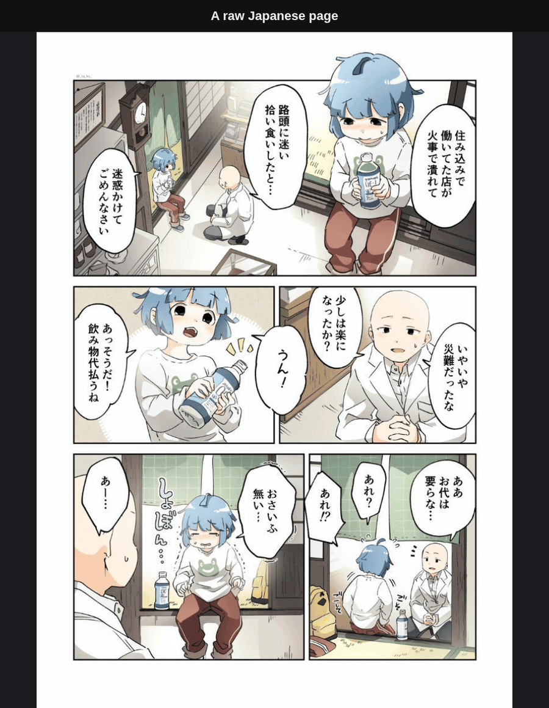

<p align="center"></p>

# Yomikae

[](LICENSE)


Yomikae translates raw Japanese manga into English while you read it in Chrome. A browser extension sends each page image to a server on your own computer. The server finds the text, reads it, translates it with a local LLM, erases the Japanese, and letters the English into the speech balloons. The extension then shows the translated page in place of the original.

The name comes from 読み替え (yomikae), Japanese for "reading something as something else."



*Demo pages from the OpenMantra dataset (Hinami et al., AAAI 2021), CC BY-NC 4.0, translated by Yomikae.*

## What you need

- Linux and an NVIDIA GPU with CUDA. Yomikae was developed on an RTX 5070 Ti with 16 GB, which runs the server and a 12B translation model side by side. Other platforms are untested.
- Python 3.12 or newer, [uv](https://docs.astral.sh/uv/), git, and a C++ compiler. The install builds `pydensecrf` from source.
- Node.js 22.23.4, 24.22.1, or 26.12.1 or newer, and [pnpm](https://pnpm.io/). Older Node releases have the Brotli decoder flaw CVE-2026-111497.
- Chrome or Chromium 116 or newer.
- [LM Studio](https://lmstudio.ai/), or another LLM server with an OpenAI-compatible API.

The server holds about 3 GB of graphics memory while you read, and the LLM takes the rest. With a smaller GPU, pick a smaller model from [docs/models.md](docs/models.md), or move the server's work to the CPU as [docs/performance.md](docs/performance.md) explains.

## Install

These steps take a fresh clone to a translated page. Plan on about 15 GB of disk. The server's venv takes about 7.5 GB, most of it PyTorch with CUDA, and a 12B model about 7 GB more.

### 1. Install the server

```sh
git clone https://github.com/gravewhisper/yomikae.git
cd yomikae/server
uv venv --python 3.12 .venv
uv pip install --python .venv/bin/python torch --index-url https://download.pytorch.org/whl/cu128
uv pip install --python .venv/bin/python -e '.[test]'
```

Run the rest of the server steps from `server/` too.

### 2. Download the models

The server needs three model files in `server/models/`. Download the text detector and the inpainting model:

```sh
mkdir -p models
curl -L -o models/comictextdetector.pt.onnx https://github.com/zyddnys/manga-image-translator/releases/download/beta-0.3/comictextdetector.pt.onnx
curl -L -o models/lama_large_512px.ckpt https://huggingface.co/dreMaz/AnimeMangaInpainting/resolve/main/lama_large_512px.ckpt
```

The speech balloon segmenter ships only as PyTorch weights, so convert it to ONNX once. These commands do it in a throwaway venv and then delete it:

```sh
uv venv --python 3.12 .venv-export
uv pip install --python .venv-export/bin/python --torch-backend cpu ultralytics onnx onnxslim
curl -L -o best.pt https://huggingface.co/huyvux3005/manga109-segmentation-bubble/resolve/main/best.pt
.venv-export/bin/yolo export model=best.pt format=onnx imgsz=1600 opset=17 simplify=True
mv best.onnx models/manga109-bubble-seg.onnx
rm -rf best.pt .venv-export
```

The export ends with `export success` and saves `best.onnx`, about 12 MB. manga-ocr, the fourth model, downloads itself the first time the server starts.

### 3. Start the translator

The default translator is Google's Gemma 4 12B in LM Studio. Install LM Studio, then download the model, load it, and start LM Studio's server:

```sh
lms get google/gemma-4-12b
lms load google/gemma-4-12b -y
lms server start
```

To use another model or another LLM server, see [Use another translator](#use-another-translator).

### 4. Start the server

```sh
.venv/bin/uvicorn yomikae.app:app --host 127.0.0.1 --port 7878
```

The first start downloads the manga-ocr weights and takes about a minute. Later starts take a few seconds. In another terminal, check it:

```sh
curl http://127.0.0.1:7878/v1/health
```

The reply contains `"ok": true`. If it says `"ok": false`, its `detail` says what is wrong, most often that LM Studio is not running.

### 5. Load the extension

From `extension/`:

```sh
pnpm install
pnpm build
```

1. Open `chrome://extensions` and switch on **Developer mode**.
2. Click **Load unpacked** and select `extension/dist`.
3. Open a page of the manga you want to read and click the Yomikae toolbar icon.
4. Switch on **Translate** for the site and allow access when Chrome asks.
5. Choose **Every page, automatically** or **Only images I click Translate on**.

The popup shows whether the server is running. Next time you want to read, start LM Studio's server and the Yomikae server again. You don't need to reload the extension.

### Optional: the Anime Ace font

Dialogue is set in Shantell Sans by default. Anime Ace 2 is the usual manga lettering face, but it is free for personal use only, so the repo does not include it. To use it, get it from [Blambot](https://blambot.com/), put `animeace2_reg.ttf` in `server/fonts/`, and restart the server.

## Read with Yomikae

- Switch Yomikae on for a site and read as usual. In automatic mode, each page shows up in English in the same place on the site.
- While you read a page, the extension translates the pages after it, so they can be ready before you turn to them.
- Hold **Alt** to see the original Japanese page. Let go to go back to English.
- Hover a page to see its chip in the top right corner. The chip shows progress while the page translates, and **Retry** if it failed.
- To fix some bubbles, click **Retranslate** in the chip or press **Alt+T**. Click the bubbles to translate again, add a hint such as "Lene is a girl" or fix a name in Japanese and English, and press Enter. Only those bubbles change.
- To report a bad page, click **Report** in the chip or press **Alt+R**. Click the bubbles that are wrong or drag a box around text that was missed, type a note, and press Enter. The server saves the page and your marks to `~/.local/share/yomikae/reports/`.
- The cast sheet in Chrome's side panel lists the characters and terms of the work you are reading, with their English spellings. Open it from the popup. You can respell, delete, or add an entry, and pages that use an old spelling are redone the next time you look at them.
- If the server stops, pages show "Waiting for server…" and continue when it comes back.
- The server caches every translated page on disk, so a page you have read before loads at once.

[docs/troubleshooting.md](docs/troubleshooting.md) covers the common problems.

## Sites

Yomikae has built-in adapters for pixiv and X (x.com and twitter.com). An adapter finds the pages of a work, fetches the full-size originals, and gives the translator earlier pages as context. Both sites start in click-to-translate mode, so nothing is translated until you click **Translate** on an image.

Any other site works in click-to-translate mode. Hover an image that is at least 200 px on each side and click **Translate** in its chip. In the popup you can switch a site to translate every page automatically.

[docs/sites.md](docs/sites.md) describes each adapter and its limits. [docs/adapters.md](docs/adapters.md) explains how to write one for another site.

## Use another translator

The server sends each page to any OpenAI-compatible `/chat/completions` endpoint that accepts `response_format` with a JSON schema. Set these environment variables before you start the server:

| Variable | Default | Meaning |
| --- | --- | --- |
| `YOMIKAE_OPENAI_BASE_URL` | `http://localhost:1234/v1` | The endpoint. For Ollama, use `http://localhost:11434/v1`. |
| `YOMIKAE_OPENAI_MODEL` | `google/gemma-4-12b` | The model name the endpoint knows. Pick a model that handles Japanese. |
| `YOMIKAE_OPENAI_API_KEY` | `lm-studio` | The bearer token, for a cloud API. |

For example, to translate with a cloud API:

```sh
YOMIKAE_OPENAI_BASE_URL=https://api.example.com/v1 \
YOMIKAE_OPENAI_MODEL=<model> \
YOMIKAE_OPENAI_API_KEY=<key> \
.venv/bin/uvicorn yomikae.app:app --host 127.0.0.1 --port 7878
```

If the endpoint rejects the `reasoning_effort` field, also set `YOMIKAE_OPENAI_REASONING_EFFORT=` to an empty string.

With a cloud API, the Japanese text of each page leaves your computer, along with the dialogue of up to two earlier pages as context. Page images never leave it. Cloud models may refuse some content, which leaves those lines in Japanese or fails the page.

[docs/models.md](docs/models.md) suggests models for each amount of graphics memory. [server/README.md](server/README.md#configuration) lists every setting, including lettering case, fonts, the cache size, and CPU mode.

## How it works

The extension finds page images, fetches them with your browser session, and posts them to the local server. The server never fetches a URL itself. For each page, the server does the following:

1. comic-text-detector finds the text blocks and a mask of the lettering.
2. A YOLO11 segmentation model trained on manga finds each speech balloon's outline.
3. manga-ocr reads the Japanese in each block. Sound effects and unsure readings are dropped.
4. The translator gets the whole page in one call, with up to two earlier pages of the same work and the names already used in it as context.
5. Plain bubbles are filled with their own color. Text on screentone or art is erased with a manga-tuned LaMa model.
6. The English is set in the balloon's shape. Shouts are set larger in Bangers.

[server/README.md](server/README.md#pipeline) describes each stage in detail. [docs/contract.md](docs/contract.md) is the HTTP API and the extension's behavior.

## Security

The server listens on `127.0.0.1` and answers only the Yomikae extension and tools on your own computer. Web pages you visit cannot use it. [SECURITY.md](SECURITY.md) explains what the server and the extension guard against, and how to report a problem.

## Status

Yomikae translates Japanese into English only. It leaves sound effects drawn into the art untranslated on purpose.

These are planned but not built yet:

- A batch mode that translates a folder of images.
- Korean and Chinese.
- Setups for computers without a strong GPU.

## More docs

- [Picking a translation model](docs/models.md) suggests models for each amount of graphics memory and lists the ones measured so far.
- [Speed and graphics memory](docs/performance.md) shows where a page's time goes and the settings that trade speed for memory.
- [Troubleshooting](docs/troubleshooting.md) covers common problems and how to report a bad page.
- [Measuring a change](docs/benchmarks.md) explains the two benchmark tools and how far to trust their numbers.
- [Design decisions](docs/decisions.md) records why Yomikae works the way it does and what was tried and dropped.
- [Credits and licenses](docs/credits.md) lists the code, models, fonts, and libraries Yomikae uses.

## Contributing

[CONTRIBUTING.md](CONTRIBUTING.md) explains how to propose a change. [AGENTS.md](AGENTS.md) covers the layout, the tests, and the rules for contributors and AI coding agents.

## License

Yomikae is licensed under GPL-3.0-only, see [LICENSE](LICENSE). Parts of the server are ported from manga-image-translator under the same license. The demo images are CC BY-NC 4.0, like the OpenMantra dataset they come from. [docs/credits.md](docs/credits.md) has the details.

## Disclaimer

Yomikae translates images that your browser already shows you, on your own computer. You are responsible for following the terms of the sites you read and for having the right to translate what you read. This project is not affiliated with any site it has an adapter for.
