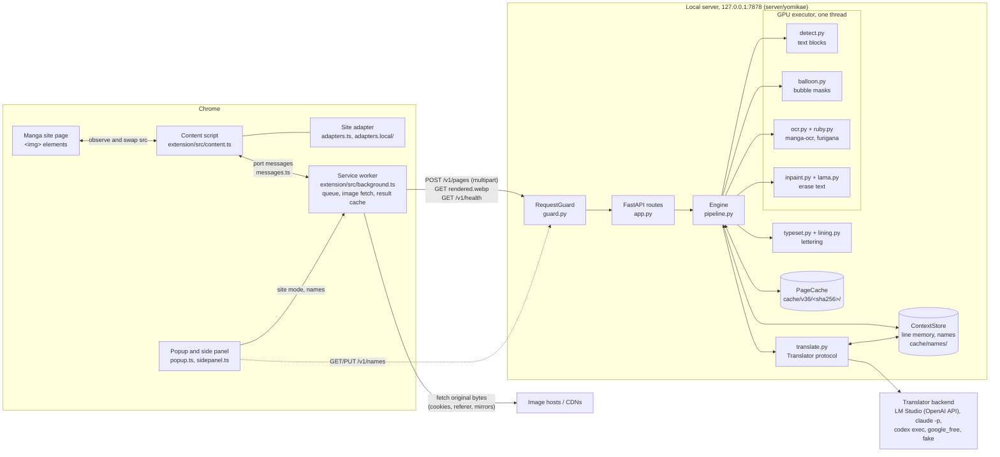

# Architecture

An onboarding guide to Yomikae for engineers new to the code. It describes `main` at `8b7bf0a` (2026-11-22). The [README](../README.md) covers installation, [docs/contract.md](contract.md) the HTTP API, and [docs/decisions.md](decisions.md) the reasons behind each behavior in detail.

## 1. What Yomikae does

Yomikae translates Japanese manga pages in place while you read them in Chrome. A Chrome extension finds the page images on a site you enabled, sends each one to a Python server running on your own computer, and swaps the original image for a version with the Japanese removed and English lettered into the speech bubbles. The server does the heavy work locally: it detects text and bubbles, reads the Japanese with OCR, translates every line of the page in one call to a translator you choose (a local model through LM Studio, a Claude or ChatGPT subscription through their CLIs, or a test translator), erases the original text, and letters the English to fit each bubble. It remembers each work's earlier pages and character names, so names and recurring lines stay consistent from page to page. Nothing goes to a third party except the text sent to the translator you chose.

## 2. Architecture

### Components

| Component | Where | Job |
|---|---|---|
| Content script | `extension/src/content.ts` | Injected only into sites you enabled. Finds page images (`scan`, `MutationObserver`, `IntersectionObserver`), keeps a job state per image, asks the background for translations, swaps the rendered image into the ``, and draws status chips, the pick modes for report and retranslate, and the Alt peek. |
| Site adapters | `extension/src/adapter.ts`, `adapters.ts`, `extension/adapters/`, `extension/adapters.local/` | Per-site knowledge: which images are pages, the `contextKey` that names a work, `pageKey`, mirror URLs, prefetch of upcoming pages, and the default mode. Private adapters are compiled in from a gitignored folder. |
| Service worker | `extension/src/background.ts` | The only part that talks to the server. Holds the job queue (2 in flight, nearest page first), fetches original images with hedged mirrors and stall timeouts, refuses local-network images, polls `/v1/health` with backoff during outages, and caches 120 renders and 40 originals in memory. |
| Sites and permissions | `extension/src/sites.ts` | Turns a host into a registrable-domain "site" (tldts), registers the content script per site with `chrome.scripting`, and stores each site's mode (`auto` or `on-demand`). |
| Popup and side panel | `popup.ts`, `sidepanel.ts`, `cast.ts`, `works.ts` | Enable sites, switch modes, and edit a work's name sheet. |
| Request guard | `server/yomikae/guard.py` | ASGI middleware. Admits only loopback clients with a loopback `Host` and a `chrome-extension://` `Origin` (optionally pinned to extension ids), caps body size, and refuses chunked uploads. |
| HTTP API | `server/yomikae/app.py` | Routes for pages, retranslate, rendered images, names, reports, cache clear, and health. Maps exceptions to the error codes in the contract. |
| Engine | `server/yomikae/pipeline.py` | Loads every model once, owns the GPU executor, dedupes concurrent uploads of the same page, orders translation within a work, runs the stages, and stores the result. |
| Reading stages | `detect.py`, `balloon.py`, `ocr.py`, `ruby.py`, `tiles.py`, `kana.py` | Text block detection (comic-text-detector, ONNX), balloon segmentation (YOLO11, ONNX), OCR (manga-ocr, torch), furigana reading. |
| Translation | `translate.py` | The `Translator` protocol and its backends, the system prompt, the reply parser, retries in halves on misaligned replies, per-line retries for unusable lines, stutter mending. |
| Erasing | `inpaint.py`, `lama.py` | Builds a text mask (refined with DenseCRF), fills flat areas directly, and uses LaMa for the rest. |
| Lettering | `typeset.py`, `lining.py` | Fits English into each bubble: one page target size, line breaking by dynamic programming, hyphenation, shouts in Bangers, centroid placement. |
| Page cache | `cache.py` `PageCache` | `cache/v{PIPELINE_VERSION}/<sha256 of image>/` holds `rendered.webp` and `result.json`. Atomic writes, LRU eviction at 2 GiB, each page stamped with its translator. |
| Context store | `cache.py` `ContextStore` | In memory, rebuilt from the cache at startup. Per work: ordered pages, line memory, and the cast (auto, furigana and user names; user and furigana names are saved under `cache/names/`). |
| Reports | `reports.py` | Saves a bug report (original, render, `result.json`, marked areas) to a local folder. |

## 3. One user action, end to end

**Action:** a reader on a site in automatic mode scrolls a new page into view, and it turns into English. This is the first time the server sees the page, the work has earlier pages, and the translator is LM Studio.

### In the browser

1. **The content script is already on the page.** When the site was enabled, `enableSite` (`extension/src/sites.ts:127`) registered `content.js` for the site's URL pattern. On load, the top of `content.ts` calls `siteForUrl`, `adapterFor`, `getSiteMode` and `loadWork`, then `start(site, adapter, mode, work)` (`content.ts:39`).
2. **The image is found.** `start` runs `scan` on every ``, and the `MutationObserver` (`content.ts:601`) runs it on images added later. `scan` (`content.ts:392`) asks the adapter for the `pageKey` of the image URL, checks `isCandidate` (the adapter's `isPage`, or size thresholds when the adapter has none), and calls `track`, which also starts observing it.
3. **It comes into view.** The `IntersectionObserver` (`content.ts:587`, with a margin of one screen above and three below) sees the tracked image intersect. In `auto` mode with no job for that key, it calls `request(key, src, placeOf(img), img)`.
4. **A request is built.** `request` (`content.ts:159`) sets the job to `queued` and awaits `makeWant`, which asks the adapter for the work's `contextKey` and the `fetchCandidates` (the URL plus any mirrors), and sets `priority` to the distance from the page the reader is on. `post` sends `{type: 'want', jobs: [want]}` over a long-lived port (`chrome.runtime.connect`).
5. **The background queues it.** The port listener (`background.ts:471`) calls `want` (`background.ts:143`). That refuses local-network URLs (`localRefusal`), answers from the in-memory result cache if it can (`sendCached`), joins an existing entry for the same key, or creates a new `Entry` in `queued` state and sends `progress` back. Then `pump` (`background.ts:215`) starts the queued entry with the lowest priority number, if fewer than `MAX_IN_FLIGHT = 2` are running and there is no outage.
6. **The original image is fetched.** `run` (`background.ts:234`) sets `fetching` and calls `fetchImage` (`background.ts:294`). It orders the candidates by host health, starts the first, and after `MIRROR_HEDGE_MS` (2 s) without a response starts the next as a hedge. Each fetch has an 8 s first-byte deadline and an 8 s stall deadline, a size cap, and a check that redirects did not land on a local address. The first complete body wins and aborts the rest. The extension's declarative net request rules (`installImageReferers`) give the request the referer the CDN expects.
7. **The page is sent to the server.** `run` sets `translating` and calls `translate` (`background.ts:377`), which builds a multipart form (`image`, `context_key`, `page_index`) and calls `postToServer` with a 180 s timeout. Network errors and 502/503/504 become `ServerDown`; other errors become a `JobError` that is retryable unless the code is `bad_image`, `bad_request` or `forbidden`.

### On the server

8. **The guard admits it.** `RequestGuard.__call__` (`guard.py:70`) checks that the client is loopback, `Host` is `127.0.0.1`/`localhost`/`[::1]`, `Origin` starts with `chrome-extension://`, and `Content-Length` is under the cap. Then the CORS middleware and FastAPI.
9. **The route hands it to the engine.** `post_page` (`app.py:116`) reads the upload and calls `Engine.process(data, context_key, page_index)`.
10. **Cache and dedupe.** `process` (`pipeline.py:218`) hashes the bytes with SHA-256; that hash is the `page_id`. `PageCache.load` returns `None` (new page). If another request for the same `page_id` is already running, it awaits that one's future (`self.inflight`). Otherwise it registers a future and calls `_run`.
11. **The page takes its turn in the work.** `_run` (`pipeline.py:257`) enters `self.turn(context_key)` (`pipeline.py:183`). That records this page as the latest in flight for the work and yields the future of the page before it, called `earlier`. Reading and erasing do not wait for it; only translation does.
12. **Decode.** `decode_image` (`pipeline.py:54`) runs in a thread: Pillow with web formats only, a 40 MP cap, alpha flattened onto white.
13. **Read the page on the GPU thread.** `read_page` runs on `self.gpu_thread`, a single-thread executor, inside `self.gpu()` (a lock that also empties the CUDA cache afterwards):
    - `detect.detect` (`detect.py:432`): comic-text-detector over the page, tiled for tall strips, then block splitting per bubble, merging and reading order.
    - `balloon.segment`: YOLO11 balloon masks.
    - `ocr.read` (`ocr.py:166`): manga-ocr on each block, with filters for sound effects and low confidence. Rejected blocks come back as `unsure` and are reported as `skipped`.
    - `ruby.attach` (`ruby.py:234`): reads the furigana beside kanji names.
14. **Translation and erasing run at the same time.** `_run` starts `_translate` as a task, then awaits `remove_text_anywhere`, which runs `inpaint.inpaint` (`inpaint.py:140`) on the GPU thread and falls back to a CPU LaMa on CUDA out-of-memory.
15. **Translation waits for the earlier page.** `_translate` (`pipeline.py:341`) awaits `earlier`, so the work's previous page has stored its lines first, then calls `translate_page` (`pipeline.py:361`):
    - `ContextStore.recall` reuses translations of lines already seen in this work (exact or near match), unless a saved name in the line is spelled differently in the remembered English.
    - It builds a `Context`: up to 2 earlier pages from `store.before`, the `names` and `terms` maps from `store.cast`, the recalled lines, and furigana `readings` that are not already known.
    - `translate_lines` (`translate.py:262`) calls `aligned`, which calls `OpenAICompatible.translate` once with every remaining line. The model must reply `{"translations": [...]}` with one string per line. A reply with the wrong count raises `Misaligned`, and `aligned` retries in halves, stopping when the replies for both halves hold no list of translations, as in a refusal. Lines that come back still in Japanese, with no words, or with a word cut across two lines are retried one at a time. Kin words lose their honorific.
    - `mend_stutters` turns a lone cut-off kana before the same sound into "D-" style stutters.
    - `store.learn_names` records new names spelled from furigana.
    - If no line got English and a reply was unreadable, it raises `TranslatorFailed`, and nothing is cached.
16. **Letter the page.** Lines left blank keep their original Japanese (`keep_original`). `typeset.typeset` (in a thread) letters each bubble on the erased image and returns the font sizes.
17. **Encode and store.** `encode` (`pipeline.py:71`) writes WebP at quality 90 (JPEG or PNG for very tall pages). `PageCache.store` writes `rendered.webp` and `result.json` atomically, stamped with the translator name. `ContextStore.add` adds the page's lines to the work's memory. Leaving the `turn` block releases the next page of the work.
18. **Respond.** `post_page` drops internal fields and returns the JSON: `page_id`, size, `rendered_url` (`/v1/pages/<id>/rendered.webp`), `bubbles` with boxes, source and translation, `timings_ms`, `cached: false`. If the cache is over 2 GiB, `schedule_eviction` starts an LRU eviction in the background.

### Back in the browser

19. **Fetch the render.** `readyFrom` (`background.ts:386`) parses the JSON with `parseTranslatedPage` (`contract.ts`), fetches `rendered_url` from the server (`rendered`, `app.py:278`), and base64-encodes the bytes, because a content script cannot call the server itself (its requests carry the web page's origin, which the guard refuses).
20. **Broadcast.** `run` stores the result in the in-memory `results` cache and broadcasts `{type: 'ready', key, page, mime, base64, contextKey}` to every tab port that wants this key.
21. **Swap the image.** `onMessage` in `content.ts` (`content.ts:98`) decodes the base64 into a `Blob`, makes a blob URL, pre-decodes it with `new Image()`, records the job as `ready`, and calls `showTranslated` (`content.ts:428`) on every `` with that key. It saves the original `src` and `srcset`, removes `srcset` (and those of `<picture>` sources), sets `img.src` to the blob URL, and crossfades from a ghost of the original. Holding Alt calls `showOriginal` to peek.

A second visit to the same page stops at step 5 if the service worker still has it, or at step 10 on the server: `PageCache.load` finds it, `stale_bubbles` checks that no name used on the page has changed since, and the cached JSON returns with `cached: true`.

## 4. Key design decisions

[docs/decisions.md](decisions.md) has the full record. These are the decisions that shape the architecture.

| Decision | What we chose | Alternatives | Trade-off |
|---|---|---|---|
| Where the work runs | A local Python server plus a thin extension. | Run models in the browser (ONNX Web/WebGPU); a hosted cloud service. | Local gives a real GPU, full PyTorch, privacy and no hosting cost. The price is an install step (venv, three model files, a running server), so it is for technical users only, and it runs on one machine. |
| What the server returns | A finished image with the English lettered in; the extension swaps the `src`. | Return text and boxes and draw an HTML overlay. | Lettering can erase art properly and fit text with real typography, and the page looks like a scanlation. The cost is a full image round trip for every page and every retranslate, and no selectable text. |
| How the extension reaches the server | Only the service worker calls the server; the render reaches the tab as base64 over a port. | Content script calls the server directly; a token. | Keeps the server's caller check simple (only `chrome-extension://` origins). Costs memory and CPU for base64 and keeps renders in service worker memory. |
| How the server is protected | No token: loopback-only, Host allowlist, `chrome-extension://` Origin, optional extension-id pin. | A shared secret configured in both; no protection. | Nothing to set up, and web pages and DNS rebinding are refused. Another installed extension can still call it unless ids are pinned. |
| Translation unit | The whole page in one call, with 2 earlier pages, the name list and already-known lines as context. | One call per bubble; one call per chapter. | Context improves pronouns, tone and names, and one call is cheaper than many. A misaligned reply needs recovery (halving), and one bad page reply affects every line. |
| Order within a work | Pages of one `context_key` translate one at a time in arrival order (`Engine.turn`); reading and erasing still overlap. | Fully parallel; order by `page_index`. | Each page sees the previous page's lines and names. Long series queue behind slow pages. |
| What goes to the translator | OCR text only, never the page image. | Send the image to a vision model. | Works with small local text models and costs fewer tokens. The model cannot see who is speaking or what is drawn. |
| Translator backends | A `Translator` protocol with OpenAI-compatible (LM Studio), `claude -p`, `codex exec`, `google_free` and `fake`. | One hard-wired backend. | Users choose between local and subscription models, and tests use `fake`. The CLIs cost a process start per call. |
| Cache identity | The SHA-256 of the image bytes is the page id; the folder is versioned by `PIPELINE_VERSION`; each page is stamped with its translator. | Key by URL; per-stage versions. | The same image from any mirror or URL hits the cache, and stale renders are never served. Any change to rendering or translation throws away every cached page and the line memory built from it. |
| Context store | In memory, rebuilt from cached `result.json` files at startup; only user and furigana names are saved on their own. | SQLite or another persistent store. | One source of truth (the cache) and no migrations. Startup and every lookup scale with the number of pages. |
| GPU scheduling | One single-thread executor for all GPU stages, plus a lock that empties the CUDA cache; translation overlaps erasing. | A pool of GPU workers; batching across pages. | Predictable memory on one card shared with a local LLM. Throughput is one page at a time on the GPU. |
| Retranslate | Re-uploads the image and runs detection, OCR and erasing again; picked bubbles get new English and the rest keep theirs. | Store the post-OCR stage and the erased image. | The cache stays small and OCR fixes reach old pages. Each retranslate costs seconds of GPU time. |
| Lettering | Text never leaves its bubble; one target size per page; hyphenate, then shrink; never squeeze letters. | Let text spill with a stroke; condense the face. | Clean outlines and even sizes across a page. Narrow bubbles get small text. |
| Sites | Per-site enablement and mode (`auto` or `on-demand`); adapters for piracy or aggregator sites stay out of the repo and compile in from `adapters.local/`. | Run on every site; ship all adapters. | Keeps the public repo clean and the permission scope narrow. Private adapters are untested by CI. |
| Distribution | Load unpacked from your own build, GPL-3.0-only. | Chrome Web Store. | No store review or policy risk. Every user builds and updates by hand. |
